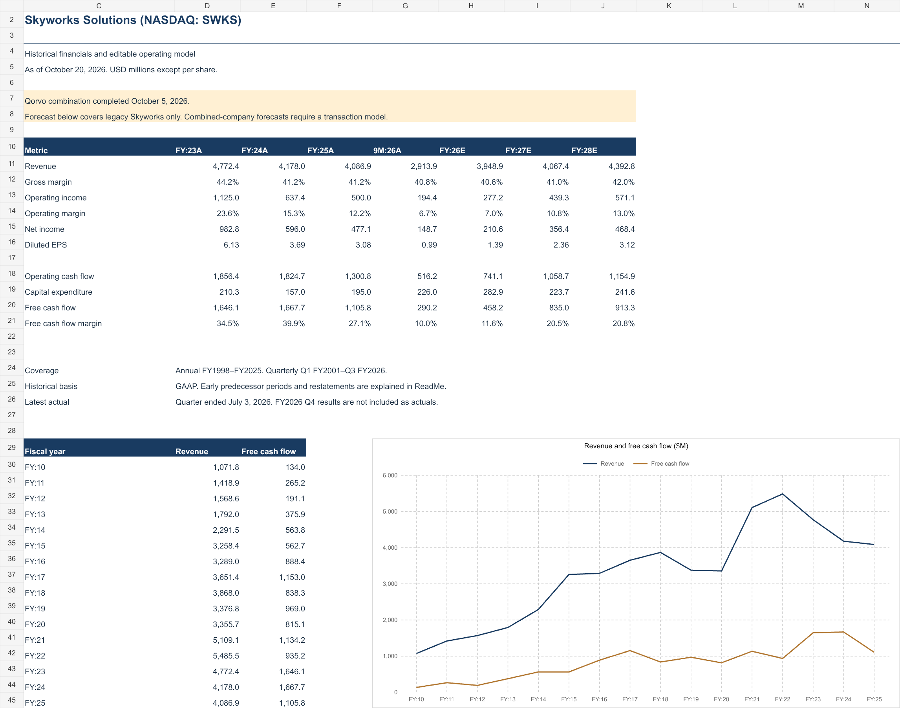

# Skyworks Solutions financial analysis

Historical financial analysis and an editable Excel operating model for **Skyworks Solutions (NASDAQ: SWKS)**, prepared as of **October 20, 2026**.



## Workbook

[Download the Excel financial model](outputs/swks_20261020/Skyworks_Financial_Model.xlsx).

- Annual history from FY1998 through FY2025, including selected Conexant wireless predecessor financials.
- Quarterly history from Q1 FY2001 through Q3 FY2026, with availability varying by metric.
- Income statements, balance sheets, cash flows, operating ratios, and a revenue/free-cash-flow chart.
- Editable legacy Skyworks operating forecasts through FY2030.
- Source register, accounting notes, and reconciliation checks.

**Forecast scope:** the forecasts exclude Qorvo revenue, acquisition financing, new shares, integration costs, synergies, and purchase accounting. They do not represent the combined company. Early historical gaps are marked `n.a.`.

## Sources and methodology

Historical inputs come from [SEC Company Facts for CIK 0000004127](https://data.sec.gov/api/xbrl/companyfacts/CIK0000004127.json), [Skyworks annual reports](https://investors.skyworksinc.com/annual-reports-and-proxies), archived issuer reports, and selected earnings releases. Detailed citations are included in the workbook's **Source data** sheet.

Quarterly cash flows are derived from cumulative statements where necessary. EPS is never calculated by subtracting year-to-date EPS. Older accounting revisions and predecessor comparability are documented in **ReadMe** and **Audit**. Not every earnings-call transcript was reviewed.

## Files and reproduction

| File | Purpose |
| --- | --- |
| `companyfacts.json` | Public SEC financial dataset used for this snapshot |
| `prepare_data.py` | Normalize SEC data and supplement archived report figures |
| `model_data.json` | Historical inputs and source lineage |
| `build_model.mjs` | Generate, recalculate, inspect, render, and export the workbook |
| `verify_export.py` | Check exported formulas, historical values, and reconciliations |
| `fetch_sources.py` | Download supplementary public research sources |

The workbook builder uses `@oai/artifact-tool` from the Codex bundled runtime. Use a runtime that supplies that package; it is not vendored into this repository. With the required runtime available:

```sh
python prepare_data.py
node build_model.mjs
python verify_export.py
```

Downloaded annual-report PDFs, dependency directories, local configuration, and credentials are excluded from version control. The SSH key used for publishing is kept outside the repository.

Commit timestamps were intentionally distributed across August–October 2026. They do not represent the actual development timeline; the model and source snapshot are dated October 20, 2026.
